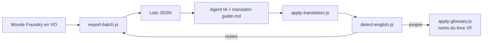

# foundry-vf-toolkit

**Traduire une aventure Foundry VTT en français avec un agent IA, et fusionner les cartes MAD Cartography avec les jetons de l'aventure officielle.**

*English summary at the bottom.*

Ce dépôt est né d'une vraie campagne : *Phandelver and Below: The Shattered Obelisk* (D&D 2024), achetée en anglais sur Foundry VTT v14, et un MJ qui voulait jouer entièrement en français. Avec Claude Code et le serveur [foundry-vtt-mcp](https://github.com/adambdooley/foundry-vtt-mcp), le monde a été traduit de bout en bout en deux jours :

- 60 journaux (678 pages), 167 acteurs, 253 objets, avec leurs effets et activités, 12 tables aléatoires, les scènes, épingles, jetons, macros et dossiers ;
- 4 compendiums du monde en VF (bestiaire, objets, options et tables de joueur), les packs du module restant intacts ;
- noms alignés sur le livre français officiel (Phandaline, Fers Rouges, Caverne du Ressac…) par un glossaire ;
- 50 scènes reconstruites : chaque carte MAD (murs, lumières, sons, variantes jour, nuit et pluie) avec les jetons et épingles de la carte officielle, placés automatiquement.

Les scripts fournis couvrent journaux, objets, acteurs et tables (export, traduction, détection), plus les noms de scènes, épingles, jetons et dossiers (glossaire). Effets, activités et macros ont été traduits au cas par cas par l'agent.

Ce dépôt contient les **outils et la méthode**, pas le contenu : aucun texte de livre, aucune image. Il te faut tes propres modules achetés.

## Ce qu'il y a dedans

| Fichier | Rôle |
|---|---|
| `scripts/foundry/export-batch.js` | Exporte journaux, objets, acteurs ou tables en lots JSON pour l'agent traducteur |
| `scripts/foundry/apply-translation.js` | Réinjecte un lot traduit : mode à blanc par défaut, refuse une traduction qui perd des balises, liens ou enrichers |
| `scripts/foundry/detect-english.js` | Liste tout ce qui est encore en anglais, avec un score |
| `scripts/foundry/apply-glossary.js` | Harmonise les noms propres partout, sans toucher au HTML, aux liens ni aux chemins (mode à blanc par défaut) |
| `scripts/foundry/copy-pack-to-world.js` | Copie un compendium de module dans un compendium du monde, avec ids et dossiers |
| `scripts/foundry/mad-combine.js` | Crée la scène « carte MAD + jetons et épingles officiels » |
| `scripts/foundry/mad-variants.js` | Décline la scène combinée sur toutes les variantes MAD (nuit, pluie…) |
| `scripts/foundry/qa-export.js` + `tools/qa_overlay.py` | Planche de contrôle : positions des jetons et épingles dessinées sur la carte |
| `tools/frame_detect.py` | Mesure le cadre imprimé de la carte officielle, la clé du calage |
| `prompts/translator-guide.md` | Consignes pour l'agent traducteur (balisage, unités, vocabulaire officiel) |
| `glossary/phandelver-fr.json` | Exemple de glossaire VO vers VF |
| `lib/` | Fonctions pures testées (transformation, glossaire, détecteur) |

`dist/` contient les scripts prêts à coller, avec `lib/` intégré (`npm run bundle`).

## Comment ça marche



Les scripts s'exécutent dans le client MJ : soit par l'outil `run-script` du serveur MCP (l'IA pilote tout), soit en les collant dans une macro de script Foundry.

### Calage des cartes MAD

La carte officielle a un cadre imprimé (marges, titre), pas la carte MAD. `frame_detect.py` cherche, près de chaque bord, la ligne la plus sombre du profil de luminosité : c'est le bord du dessin. On obtient la zone dessinée en fractions `[gauche, haut, droite, bas]`, et chaque jeton est déplacé par une simple transformation affine, centre pour centre, en tenant compte des tailles de grille différentes.

```bash
python tools/frame_detect.py goblin-ambush.webp --mad "MAD_Goblin_Ambush.webp"
# {"frame": [0.044, 0.0454, 0.9527, 0.9642], "inner_aspect": 0.717, "mad_aspect": 0.708, "aspect_gap": 0.012}
```

Un `aspect_gap` au-dessus de 3 % signale deux cartes qui ne montrent pas la même zone : vérifie avec `qa_overlay.py` avant de lancer. Les jetons tombent en général à une case près, le MJ ajuste à la main.

## Démarrage rapide

1. Foundry VTT v13 ou v14, un serveur MCP avec un outil `run-script` : le fork [JulienRabault/foundry-vtt-mcp](https://github.com/JulienRabault/foundry-vtt-mcp), branche `feat/script-tools` (proposée en amont). Active **Allow Script Execution** dans les réglages du module, seulement sur ta machine.
2. **Fais une sauvegarde du monde.**
3. Donne à ton agent (Claude Code, par exemple) ce dépôt et `prompts/translator-guide.md`. Il enchaîne export, traduction par lots, application et détection.
4. Pour les cartes : `frame_detect.py`, puis `mad-combine.js`, puis `mad-variants.js`.

```bash
npm test            # tests des fonctions pures (node >= 20)
npm run bundle      # régénère dist/
pip install -r requirements.txt   # pour les outils Python
```

## Pièges appris en route

- **Objets non identifiés (dnd5e)** : `item.name` renvoie le nom « non identifié ». Exporte et traduis `_source.name`, sinon le vrai nom est écrasé.
- **`run-script` expire après ~15 s**, mais le script continue dans Foundry. Fais des lots courts et vérifie par un second appel, ne relance pas à l'aveugle.
- **Journaux** : `apply-translation.js` modifie les documents du monde sur place. Sauvegarde avant. Si tu préfères garder la VO, duplique d'abord le dossier de journaux et exporte la copie ; les `@UUID[...]` pointent encore vers les originaux, à réécrire ensuite. Ne traduis jamais dans les compendiums du module : une mise à jour les écrase.
- **Remplacements dans le HTML** : uniquement dans les nœuds texte, sinon tu casses des classes, des chemins d'images ou des liens. `lib/glossary.js` s'en charge.
- **Grammaire après un renommage** : « le repaire » devenu « le cachette ». Relance `detect-english.js` et relis les noms changés de genre.
- **Vignettes de scènes** : `scene.createThumbnail({img})`, puis `scene.update({thumb})`.

## Licence et contenu

Code sous licence MIT. Aucun contenu sous droits n'est inclus. Le glossaire ne contient que des noms propres, pour illustrer le format. *Phandelver and Below* appartient à Wizards of the Coast, les cartes à MAD Cartographer. Ce projet n'est affilié à aucun des deux.

---

## English summary

Tools and method to **translate a whole Foundry VTT adventure world with an AI agent** (journals, actors, items, effects, tables, scenes, pins, compendiums), plus a **battlemap merger**. The merger detects the printed frame of the official map, then moves the official tokens and pins onto the MAD Cartography map and all its day, night and rain variants. Scripts run inside Foundry through an MCP `run-script` tool or a script macro. Pure helpers are unit-tested (`npm test`). No copyrighted content is included.
